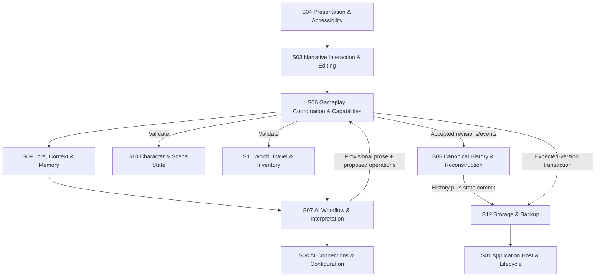

# Consolidated Subsystem Architecture

## Status, scope, and source of authority

**Pass B consolidation accepted 2026-10-19.** Lorebound's 52 accepted staging ideas are grouped into **12 logical top-level subsystems**. The source [Pass A Subsystem Mapping Register](./Subsystem%20Mapping%20Register.md) remains **unchanged** and preserves each originally accepted primary/secondary subsystem, idea-specific boundary, dependency and deferral.

This document consolidates **architectural ownership only**. It does not promote ideas out of `planning/staging/`, authorise production implementation, fix runtime module/folder boundaries, require 12 packages/processes, or supersede individual idea-specific accepted directions. In a disagreement, retain the source idea's accepted behaviour and record the discrepancy for explicit refinement instead of quietly altering product scope.

**Terminology:** *Lorebound* is one product. *Lore Engine* is the conceptual umbrella for non-UI functions spanning browser-resident TypeScript gameplay/model modules and supporting Go/Wails/SQLite platform services; it is **not** a second separately deployed game server. The **12 groups are responsibility boundaries**, not runtime partitions.

## Decision summary

- **Before:** 28 distinct primary subsystem names, 30 legacy names counting labels used only as secondary touchpoints.
- **After:** 12 top-level logical subsystems retaining 30 legacy responsibilities as internal domains/modules.
- **Coverage:** 52/52 source staging ideas, each with one consolidated primary owner and deduplicated consolidated secondary touchpoints.
- **Storage/runtime:** One Wails v3 headless Go localhost host serves the ordinary-browser SvelteKit UI; gameplay coordinator, rules and model clients are browser TypeScript; Go protects SQLite/filesystem/credential services. One shared SQLite database; only whole-database backup/restore files.
- **Canonical authority:** AI offers provisional narrative/typed operations; deterministic TypeScript coordinator and world validators approve; Go/SQLite enforces atomic durable/expected-version writes. Accepted versioned history permits complete deterministic replay without rerunning model outcomes.

## 1. Consolidated subsystem register

| ID | Top-level subsystem | Pass A primary ideas | Former responsibilities grouped here |
|---|---|---:|---|
| **S01** | **Application Host & Lifecycle** | 3 | Application Foundation & Lifecycle; Runtime & Platform Services; Credential & Secret Storage |
| **S02** | **Adventure Library & Initialization** | 5 | Adventure Library & Persistence; Adventure Initialization & Setup; Scenario Templates & Configuration |
| **S03** | **Narrative Interaction & Editing** | 4 | Narrative Interaction & Intent; Narrative Document & Editing |
| **S04** | **Presentation & Accessibility** | 2 | Presentation & UX |
| **S05** | **Canonical History & Reconstruction** | 4 | Narrative History & Versioning; World State Reconstruction |
| **S06** | **Gameplay Coordination & Capabilities** | 4 | Adventure Coordinator; Gameplay Capability Registry & Plugins; World Rules & Validation |
| **S07** | **AI Workflow & Interpretation** | 4 | AI Generation Pipeline; Generation Lifecycle & Diagnostics; AI Task Routing & Model Selection; AI Interpretation & Operation Proposals |
| **S08** | **AI Connections & Configuration** | 7 | AI Provider Integration; Provider Connection Management; Model Capability Management; Narrative Generation Configuration |
| **S09** | **Lore, Context & Memory** | 5 | Entity-Based Lorebook; AI Context & Prompt Construction; Narrative Memory & Retrieval |
| **S10** | **Character & Scene State** | 6 | Character & Scene State |
| **S11** | **World, Travel & Inventory** | 6 | World Locations & Topology; World Environment & Mutable State; Inventory & Item State |
| **S12** | **Storage & Backup** | 2 | Persistence & Draft Management |

**Important:** Source-role counts indicate where an idea has its **primary** Pass B owner. All major secondary touchpoints are still represented in §3. Internal modules may have dedicated contracts and files without becoming new top-level subsystems.

## 2. Responsibility boundaries

### S01 — Application Host & Lifecycle

- **Owns:** Product lifecycle and distribution; one loopback-only Wails v3 headless Go host; cross-platform startup, service exposure and native OS integration; privileged credential vault access and separately keyed encrypted-secret fallback.
- **Internal responsibility areas:** Product foundation; launcher/runtime; localhost service security; privileged OS services; secret vault adapter.
- **Does not own:** No Go gameplay engine, separate native WebView product, model HTTP proxy, Node player server, account service or second product identity.
- **Pass A primary idea count:** 3.

### S02 — Adventure Library & Initialization

- **Owns:** Adventure catalog and lifecycle (create, resume, rename, duplicate, delete, independent fork); blank/Quick Start/custom/guided entry; optional scenario-template instantiation and pre-turn AI-authored starting Lorebook workflow.
- **Internal responsibility areas:** Adventure library operations; new-adventure setup; reusable template definitions; opening/Turn-0 orchestration.
- **Does not own:** No ownership of SQLite transaction mechanics, cross-adventure state sharing, AI model transport, or automatically invented facts from ordinary opening-prose extraction.
- **Pass A primary idea count:** 5.

### S03 — Narrative Interaction & Editing

- **Owns:** Do/Say/Story/Continue intent entry and structured UI action intents; directly editable story document; noncanonical drafts; historical edit confirmation choices and player-facing edit workflow.
- **Internal responsibility areas:** Interaction modes; command entry; prose editor; historical-edit review; noncanonical editor undo.
- **Does not own:** Does not independently declare state changes valid, persist unapproved history, or bypass the coordinator when confirming historical changes.
- **Pass A primary idea count:** 4.

### S04 — Presentation & Accessibility

- **Owns:** Accessible responsive Svelte UI, story and entity views, status/equipment panels, map canvas, notifications, contextual action affordances and layout/readability preferences.
- **Internal responsibility areas:** Svelte components; navigation/layout; accessibility; map renderer; inspector and status views.
- **Does not own:** Map layout/selection are presentation, not fictional coordinates or travel actions. **The player can deliberately edit/add map location records** through validated world-state editing APIs owned by S11/S06; the map UI never bypasses that boundary or uses node clicks as gameplay input.
- **Pass A primary idea count:** 2.

### S05 — Canonical History & Reconstruction

- **Owns:** Active timeline and append-only event provenance; logical turn/passage IDs and revisions; committed Undo and historical head/truncation semantics; deterministic replay of **core and currently supported module state**, revision-aware cache/summary invalidation and optional derived checkpoints. If a plugin is removed, the adventure continues without replaying or migrating that absent plugin's custom state.
- **Internal responsibility areas:** Passage lineage; event ledger; active-history selector; reducers/replay; checkpoint management; dependent-derived-data invalidation.
- **Does not own:** No AI regeneration of previous accepted outcomes; no reliance on snapshots for correctness; no claim that superseded audit events remain active canon.
- **Pass A primary idea count:** 4.

### S06 — Gameplay Coordination & Capabilities

- **Owns:** Browser TypeScript turn coordinator, universal typed capability registry, operation dispatch, authorisation/permissions, deterministic validation, bounded rejection/repair decisions and coherent finalisation requests; optional mechanics use shared rules/contracts.
- **Internal responsibility areas:** Turn coordinator; capability contracts; permission and domain-rule interfaces; plugin integration; typed rejection and repair decision policy.
- **Does not own:** The coordinator does not become an LLM; plugins cannot commit directly or maintain independent canonical stores; validation is not replaced by a schema-valid model response.
- **Pass A primary idea count:** 4.

### S07 — AI Workflow & Interpretation

- **Owns:** Configurable one-pass / plan-validate-narrate / draft-audit-repair orchestration; per-task profile+model routing; provisional stream/cancel/status/diagnostics; extraction of proposed typed actions with uncertainty and stable entity references.
- **Internal responsibility areas:** Generation strategy executors; task router; provisional attempt lifecycle; interpreter/proposal stage; stage-level diagnostics.
- **Does not own:** Does not determine world-rule validity, mutate canon directly, require a second loaded model, or retain cancelled/failed/retried/tab-abandoned provisional output as an accepted turn. Browser-owned AI requests/streams are aborted where supported and late results are ineligible for commit.
- **Pass A primary idea count:** 4.

### S08 — AI Connections & Configuration

- **Owns:** Browser-initiated cloud/local provider adapters, reusable profiles and model discovery, known/ignored/unsupported/unknown capability policy, **one shared current generation-parameter settings entry**, optional explicitly selected technical sampling presets, style preferences and persistent author-note configuration. Switching model/provider reevaluates frontend controls and effective request parameters rather than switching active stored preferences.
- **Internal responsibility areas:** Provider adapters; profile/model catalog; effective-request parameter mapping; model capability registry; sampling presets; narration/author instructions.
- **Does not own:** No Go/Node model transport proxy; provider responses are not canonical world operations; style notes and decoding controls cannot override validated world rules. Secret storage remains S01's privileged service.
- **Pass A primary idea count:** 7.

### S09 — Lore, Context & Memory

- **Owns:** Persistent entity-based descriptive lore and beliefs; manual/conditional selection; long-term derived summaries, episodic indexing/retrieval; token-budgeted model-aware context construction and requested/selected/transmitted inspection.
- **Internal responsibility areas:** Lorebook and fact/belief links; activation rules; source-provenanced summaries; episodic search; context budget/inspector.
- **Does not own:** No independent mutable character/item/location facts, no stale summaries as authority, no silent reintroduction of explicitly excluded lore, no mandatory embeddings/RAG.
- **Pass A primary idea count:** 5.

### S10 — Character & Scene State

- **Owns:** Stable universal characters without PC/NPC classification; optional Playing As selection references; editable and automatically maintained validated status sheets; free-form anatomy/transformation state; physical location, presence, transit and remote participation.
- **Internal responsibility areas:** Character identity; current statuses; anatomy; presence/scene participation; actor-selection state.
- **Does not own:** Does not own location hierarchy/routes, item identity/custody, or assume a character is present based solely on being mentioned or selected.
- **Pass A primary idea count:** 6.

### S11 — World, Travel & Inventory

- **Owns:** Persistent unique items and custody; equipment slots; stable nested locations and a separate travel graph; location **discovered/undiscovered** state separate from player map-editor visibility; mutable routes, doors, containers and environmental conditions. Domain-specific rules for movement, validated anatomy-triggered equipment adjustments and manual world edits integrate with S06.
- **Internal responsibility areas:** Item identity/custody and equipment; place hierarchy and graph; discovery flags, editable recorded location details and separately controlled fictional knowledge; environmental conditions; validated world-domain transitions.
- **Does not own:** No global Player Inventory, automatically inferred travel edge from containment, duplicate unique item placement, or travel to a location solely because narration claims it.
- **Pass A primary idea count:** 6.

### S12 — Storage & Backup

- **Owns:** Go-managed single shared filesystem SQLite adventure library; logical adventure isolation; drafts and committed transactions with stale-write protection; **exclusive Go maintenance/write gate before full-library Backup or Restore**, transaction quiescence and library-epoch invalidation on Restore/directory change; consistent full-library SQLite snapshot backup and deliberate full-library replacement restore.
- **Internal responsibility areas:** SQLite schema/data access; atomic commit boundary; draft persistence; optimistic version checks; consistent backup/restore.
- **Does not own:** No browser-local canonical save, per-adventure file export, multi-library merger, independent game-rule engine, credential values within SQLite or automatic restore reconciliation.
- **Pass A primary idea count:** 2.

## 3. Complete 52-idea ownership map

The table is sorted by original IDEA ID. Links point to the **unchanged staged idea**. “Pass A primary” is preserved literally. “Pass B primary” is the new parent owner; “Pass B secondary” translates and deduplicates every original Pass A secondary touchpoint, excluding the primary parent itself. The source Pass A register remains authoritative for detailed idea-level responsibility and dependencies.

| Staged idea | Title | Pass A primary owner | Pass B primary | Pass B secondary |
|---|---|---|---|---|
| [IDEA-0001](../staging/Single-Player%20Account-Free%20Experience.md) | Single-Player Account-Free Experience | Application Foundation & Lifecycle | **S01** | S02, S08 |
| [IDEA-0002](../staging/Freeform%20Player%20Action%20Modes.md) | Freeform Player Action Modes | Narrative Interaction & Intent | **S03** | S04, S06, S10 |
| [IDEA-0003](../staging/Direct%20Editable%20Prose%20Document.md) | Direct Editable Prose Document | Narrative Document & Editing | **S03** | S04, S05, S06, S12 |
| [IDEA-0004](../staging/Retry%20Undo%20and%20Alternative%20Continuations.md) | Retry Undo and Alternative Continuations | Narrative History & Versioning | **S05** | S03, S04, S06, S07, S12 |
| [IDEA-0005](../staging/Adventure%20Save%20and%20Export%20Management.md) | Adventure Save and Export Management | Adventure Library & Persistence | **S02** | S01, S04, S05, S12 |
| [IDEA-0006](../staging/Quick%20Start%20and%20Custom%20Story%20Openings.md) | Quick Start and Custom Story Openings | Adventure Initialization & Setup | **S02** | S04, S06, S07 |
| [IDEA-0007](../staging/Character%20Creation%20and%20Starting%20Choices.md) | Character Creation and Starting Choices | Character & Scene State | **S10** | S02, S03, S04, S06, S09 |
| [IDEA-0008](../staging/Reusable%20Scenario%20Templates%20and%20Placeholders.md) | Reusable Scenario Templates and Placeholders | Scenario Templates & Configuration | **S02** | S06, S09, S10 |
| [IDEA-0010](../staging/Narration%20Style%20and%20Perspective%20Controls.md) | Narration Style and Perspective Controls | Narrative Generation Configuration | **S08** | S02, S04, S07, S09 |
| [IDEA-0011](../staging/Manual%20Generation%20Branches.md) | Manual Generation Branches | Adventure Library & Persistence | **S02** | S04, S05, S06 |
| [IDEA-0012](../staging/Cloud%20LLM%20Provider%20Connectors.md) | Cloud LLM Provider Connectors | AI Provider Integration | **S08** | S07 |
| [IDEA-0013](../staging/Local%20LLM%20Server%20Connections.md) | Local LLM Server Connections | AI Provider Integration | **S08** | S07 |
| [IDEA-0014](../staging/Provider%20Connection%20Profiles%20and%20Discovery.md) | Provider Connection Profiles and Discovery | Provider Connection Management | **S08** | S01, S04 |
| [IDEA-0015](../staging/Model-Capability-Aware%20Controls.md) | Model-Capability-Aware Controls | Model Capability Management | **S08** | S04 |
| [IDEA-0016](../staging/Sampling%20Presets%20and%20Advanced%20Parameters.md) | Sampling Presets and Advanced Parameters | Narrative Generation Configuration | **S08** | S04 |
| [IDEA-0017](../staging/One-Model%20Task%20Routing.md) | One-Model Task Routing | AI Task Routing & Model Selection | **S07** | S08 |
| [IDEA-0018](../staging/Configurable%20Generation%20Pipeline%20Strategies.md) | Configurable Generation Pipeline Strategies | AI Generation Pipeline | **S07** | S05, S06 |
| [IDEA-0019](../staging/Streaming%20Cancellation%20and%20Generation%20Diagnostics.md) | Streaming Cancellation and Generation Diagnostics | Generation Lifecycle & Diagnostics | **S07** | S04, S06, S08, S12 |
| [IDEA-0020](../staging/Entity-Based%20Lorebook.md) | Entity-Based Lorebook | Entity-Based Lorebook | **S09** | S02, S04, S06, S10 |
| [IDEA-0021](../staging/Conditional%20Lorebook%20Activation.md) | Conditional Lorebook Activation | AI Context & Prompt Construction | **S09** | S04, S06 |
| [IDEA-0022](../staging/Automatic%20Long-Term%20Story%20Summaries.md) | Automatic Long-Term Story Summaries | Narrative Memory & Retrieval | **S09** | S05, S07 |
| [IDEA-0023](../staging/Episodic%20Memory%20Retrieval.md) | Episodic Memory Retrieval | Narrative Memory & Retrieval | **S09** | S02, S05 |
| [IDEA-0024](../staging/Token-Budgeted%20Context%20Builder%20and%20Inspector.md) | Token-Budgeted Context Builder and Inspector | AI Context & Prompt Construction | **S09** | S04, S08 |
| [IDEA-0025](../staging/Author%20Notes%20and%20Persistent%20Story%20Instructions.md) | Author Notes and Persistent Story Instructions | Narrative Generation Configuration | **S08** | S02, S04, S09 |
| [IDEA-0026](../staging/Shared%20PC%20and%20NPC%20Character%20Entities.md) | Shared PC and NPC Character Entities | Character & Scene State | **S10** | S02, S03, S06, S09 |
| [IDEA-0027](../staging/Customisable%20Character%20Status%20Sheets.md) | Customisable Character Status Sheets | Character & Scene State | **S10** | S04, S06, S09 |
| [IDEA-0029](../staging/Persistent%20Items%20and%20Inventory%20Transfers.md) | Persistent Items and Inventory Transfers | Inventory & Item State | **S11** | S05, S06, S10 |
| [IDEA-0030](../staging/Slot-Based%20Equipment%20and%20Body%20Diagram.md) | Slot-Based Equipment and Body Diagram | Inventory & Item State | **S11** | S04, S06, S09, S10 |
| [IDEA-0031](../staging/Configurable%20Anatomy%20and%20Transformations.md) | Configurable Anatomy and Transformations | Character & Scene State | **S10** | S05, S06, S09, S11 |
| [IDEA-0033](../staging/Hierarchical%20World%20Locations.md) | Hierarchical World Locations | World Locations & Topology | **S11** | S06, S09, S10 |
| [IDEA-0034](../staging/Character%20Presence%20and%20Current%20Scene.md) | Character Presence and Current Scene | Character & Scene State | **S10** | S03, S04, S06, S09, S11 |
| [IDEA-0035](../staging/Configurable%20Travel%20Graph%20Rules.md) | Configurable Travel Graph Rules | World Locations & Topology | **S11** | S02, S06, S10 |
| [IDEA-0036](../staging/AI%20World%20Discovery%20and%20Expansion.md) | AI World Discovery and Expansion | World Locations & Topology | **S11** | S06, S07, S09, S10 |
| [IDEA-0037](../staging/Zoomable%20Node%20Map%20Canvas.md) | Zoomable Node Map Canvas | Presentation & UX | **S04** | S02, S10, S11 |
| [IDEA-0038](../staging/Persistent%20Location%20State%20and%20Travel%20Interactions.md) | Persistent Location State and Travel Interactions | World Environment & Mutable State | **S11** | S05, S06, S10 |
| [IDEA-0039](../staging/Event-Sourced%20World%20History.md) | Event-Sourced World History | Narrative History & Versioning | **S05** | S06, S12 |
| [IDEA-0040](../staging/Versioned%20Text%20Blocks%20and%20Revision%20IDs.md) | Versioned Text Blocks and Revision IDs | Narrative History & Versioning | **S05** | S03, S06, S12 |
| [IDEA-0041](../staging/Historical%20Edit%20Confirmation%20and%20Bulk%20Truncation.md) | Historical Edit Confirmation and Bulk Truncation | Narrative Document & Editing | **S03** | S04, S05, S06, S12 |
| [IDEA-0042](../staging/Snapshots%20and%20Incremental%20State%20Rebuild.md) | Snapshots and Incremental State Rebuild | World State Reconstruction | **S05** | S06, S09, S12 |
| [IDEA-0044](../staging/Deterministic%20Adventure%20Coordinator.md) | Deterministic Adventure Coordinator | Adventure Coordinator | **S06** | S05, S07, S09, S12 |
| [IDEA-0045](../staging/LLM%20State%20Interpreter%20and%20Proposed%20Operations.md) | LLM State Interpreter and Proposed Operations | AI Interpretation & Operation Proposals | **S07** | S06, S09 |
| [IDEA-0046](../staging/Typed%20Tool%20Rejection%20and%20Narrative%20Repair.md) | Typed Tool Rejection and Narrative Repair | Adventure Coordinator | **S06** | S07 |
| [IDEA-0047](../staging/Native%20Gameplay%20Capability%20Registry.md) | Native Gameplay Capability Registry | Gameplay Capability Registry & Plugins | **S06** | S05, S07 |
| [IDEA-0050](../staging/Structured%20UI%20Game%20Actions.md) | Structured UI Game Actions | Narrative Interaction & Intent | **S03** | S04, S06, S07 |
| [IDEA-0051](../staging/Browser-Persistent%20Story%20Database.md) | Browser-Persistent Story Database | Persistence & Draft Management | **S12** | S01, S02, S05 |
| [IDEA-0052](../staging/Backups%20Export%20and%20Storage%20Quotas.md) | Backups Export and Storage Quotas | Persistence & Draft Management | **S12** | S01, S02, S04, S05 |
| [IDEA-0053](../staging/Localhost%20Startup%20and%20Offline%20Mode.md) | Localhost Startup and Offline Mode | Runtime & Platform Services | **S01** | S04, S08, S12 |
| [IDEA-0055](../staging/Optional%20RPG%20Mechanics%20Plugins.md) | Optional RPG Mechanics Plugins | Gameplay Capability Registry & Plugins | **S06** | S04, S05 |
| [IDEA-0061](../staging/Lorebound%20Branding%20and%20Engine%20Split.md) | Lorebound Branding and Engine Split | Application Foundation & Lifecycle | **S01** | S04, S06, S12 |
| [IDEA-0062](../staging/Accessibility%20and%20Customisable%20Interface.md) | Accessibility and Customisable Interface | Presentation & UX | **S04** | S01, S02, S03, S06 |
| [IDEA-0064](../staging/Automatic%20Character%20Sheet%20Tracking.md) | Automatic Character Sheet Tracking | Character & Scene State | **S10** | S04, S05, S06, S07 |
| [IDEA-0066](../staging/AI-Generated%20Starting%20Lorebook%20and%20World.md) | AI-Generated Starting Lorebook and World | Adventure Initialization & Setup | **S02** | S06, S07, S09, S11 |

**Coverage check:** exactly **52 distinct staged ideas** appear above, with one Pass B primary each. The original accepted primary idea names and their per-idea secondary touchpoints are preserved in Pass A, and the new secondary columns give the consolidated equivalents.

## 4. Exhaustive old-to-new subsystem label map

This table includes **all 30 unique Pass A subsystem labels**, whether originally used as primary or only as secondary. Every legacy label resolves to exactly one of the 12 new parent owners.

| Legacy subsystem label | Consolidated owner | Historical usage |
|---|---|---|
| Adventure Coordinator | S06 — Gameplay Coordination & Capabilities | Primary and/or secondary |
| Adventure Initialization & Setup | S02 — Adventure Library & Initialization | Primary and/or secondary |
| Adventure Library & Persistence | S02 — Adventure Library & Initialization | Primary and/or secondary |
| AI Context & Prompt Construction | S09 — Lore, Context & Memory | Primary and/or secondary |
| AI Generation Pipeline | S07 — AI Workflow & Interpretation | Primary and/or secondary |
| AI Interpretation & Operation Proposals | S07 — AI Workflow & Interpretation | Primary and/or secondary |
| AI Provider Integration | S08 — AI Connections & Configuration | Primary and/or secondary |
| AI Task Routing & Model Selection | S07 — AI Workflow & Interpretation | Primary and/or secondary |
| Application Foundation & Lifecycle | S01 — Application Host & Lifecycle | Primary and/or secondary |
| Character & Scene State | S10 — Character & Scene State | Primary and/or secondary |
| Credential & Secret Storage | S01 — Application Host & Lifecycle | Secondary only |
| Entity-Based Lorebook | S09 — Lore, Context & Memory | Primary and/or secondary |
| Gameplay Capability Registry & Plugins | S06 — Gameplay Coordination & Capabilities | Primary and/or secondary |
| Generation Lifecycle & Diagnostics | S07 — AI Workflow & Interpretation | Primary and/or secondary |
| Inventory & Item State | S11 — World, Travel & Inventory | Primary and/or secondary |
| Model Capability Management | S08 — AI Connections & Configuration | Primary and/or secondary |
| Narrative Document & Editing | S03 — Narrative Interaction & Editing | Primary and/or secondary |
| Narrative Generation Configuration | S08 — AI Connections & Configuration | Primary and/or secondary |
| Narrative History & Versioning | S05 — Canonical History & Reconstruction | Primary and/or secondary |
| Narrative Interaction & Intent | S03 — Narrative Interaction & Editing | Primary and/or secondary |
| Narrative Memory & Retrieval | S09 — Lore, Context & Memory | Primary and/or secondary |
| Persistence & Draft Management | S12 — Storage & Backup | Primary and/or secondary |
| Presentation & UX | S04 — Presentation & Accessibility | Primary and/or secondary |
| Provider Connection Management | S08 — AI Connections & Configuration | Primary and/or secondary |
| Runtime & Platform Services | S01 — Application Host & Lifecycle | Primary and/or secondary |
| Scenario Templates & Configuration | S02 — Adventure Library & Initialization | Primary and/or secondary |
| World Environment & Mutable State | S11 — World, Travel & Inventory | Primary and/or secondary |
| World Locations & Topology | S11 — World, Travel & Inventory | Primary and/or secondary |
| World Rules & Validation | S06 — Gameplay Coordination & Capabilities | Secondary only |
| World State Reconstruction | S05 — Canonical History & Reconstruction | Primary and/or secondary |

Retain the legacy terms as helpful names for **internal modules** or contextual contracts, not as independent top-level peers. In particular, `World Rules & Validation` remains a responsibility within S06 and `Credential & Secret Storage` remains a privileged platform responsibility within S01 even though neither was a Pass A primary.

## 5. Cross-subsystem interface boundaries

These are **conceptual contracts for refinement**, not approved TypeScript type definitions, Go HTTP route names, SQLite schemas or implementation APIs. The source subsystem owns the input; the receiving subsystem enforces its own invariant. Concrete representations, synchronisation, permission and error details require separate design approval.

| Producer → consumer | Conceptual exchange | Required invariant / receiving authority |
|---|---|---|
| **S04 → S03** | UI-entered Do/Say/Story/Continue, prose editing and nonmap typed gameplay controls | Presentation does not directly commit canonical gameplay facts. **Map node selection/drag is never travel, gameplay input or story-turn advancement.** |
| **S03 → S06** | Player intent, structured UI commands, historical edit/Undo confirmation choices | **Do/Say** express attempted actions subject to enabled ordinary rules; explicit player-authored **Story** asserts outcomes with authorial authority over fictional mechanics (IDEA-0002). Both still require validated entity/integrity contracts and coherent atomic commit. |
| **S02 → S06 / S05 / S12** | New adventure / initial baseline / duplication / fork / deletion requests | S02 owns user-visible lifecycle; S06 coordinates necessary validation, S05 selects coherent history and state, S12 enforces isolated atomic storage. |
| **S02 → S07 / S09 / S06** | Optional Quick Start opening and explicitly requested AI-authored Turn-0 Lorebook proposals | Quick Start first turn auto-commits only after complete validation. Fact-only extraction from opening text must not invent lore. Intentionally generated starting lore is separately authorised and stored before Turn 1; its review policy is still open. |
| **S08 → S07** | Provider/model profile, dynamically calculated effective parameters and direct request transport | Browser contacts cloud/local model APIs directly; no Go AI transport proxy. **One shared current generation-parameter record** is reevaluated for the active model/provider, omitting unsupported settings without deleting stored preferences. Any failed chosen-model/provider response **fails the interaction, with no automatic alternative-model fallback**. |
| **S07 → S09** | Generation task / scene / budget needs and candidate source anchors | Context assembly respects authority, manual exclusions, finite model capacity and source provenance. |
| **S09 → S07 / S08** | Requested → selected → actually transmitted context, instruction text and source/omission trace | Never claim that excluded, stale, clipped or provider-omitted context was sent. **Applicable player creative instructions are assembled in a stable documented order with no semantic conflict resolution**; their adherence is the model/player's concern. Hard canonical validation and explicit context-budget omissions still apply. |
| **S07 → S06** | Provisional prose, typed proposals and per-attempt lifecycle/status | Only **active, successfully completed** requests enter the existing selected generation/domain-validation cycle. Stop, failed stage, Retry supersession or tab closure invalidates uncommitted prose/state and aborts direct provider streaming where possible; late results cannot commit. No additional AI validation layer outside the accepted pipeline. |
| **S06 ↔ S10** | Character/entity ID resolution, sheet/anatomy/presence rules, validated character deltas | Missing values remain unknown; no forced PC/NPC class or implicit teleportation. Valid **manual character-sheet corrections are authoritative historied changes**; later automatic updates use latest accepted values. Valid anatomy changes may **trigger subsequent validated adjustment of incompatible equipment** in S11, without arbitrary inventory destinations. |
| **S06 ↔ S11** | Item custody/equipment, validated manual map edits, location travel/discovery and environment operations | Stable IDs, unique custody and distinct containment/traversal are validated. **The map is a player-facing world editor/view, never a travel command**; recorded `undiscovered` locations can still display names/details and be directly edited, while fictional discovery/AI knowledge remains distinct. Strict Do/Say/AI travel attempts use grounded bounded repair, not invented bypasses; user Story authorial exceptions and validated anatomy-related item relocations still obey data integrity. |
| **S06 → S05** | Approved turn/passage revisions, ordered accepted events, history-head transitions and invalidation requests | Changes retain exact source provenance; active canon is distinct from append-only superseded audit records. |
| **S05 ↔ S10 / S11 / S09** | Point-in-time reconstruction and derived-index/summary invalidation | Deterministic replay of core and supported installed-module records; caches and summaries are secondary projections. No model calls during replay. **Removed plugin custom state is exempt from compatibility migrations/replay guarantees**, without deleting recorded history. |
| **S06 / S05 / S02 → S12** | Existing validated commit payloads, expected adventure/library versions, draft writes, reads and lifecycle operations | Go/SQLite enforces atomicity, auth and stale-version conflicts, **not another gameplay/narrative validation pass**. While maintenance is engaged, **all library writes including drafts** are fenced from every tab, irrespective of browser cancellation cooperation. A replaced library rejects prior library-session/epoch writes after maintenance. |
| **S08 ↔ S01** | Two-way credential load, create/update, delete and invalidation through a narrow, authorised Go OS-vault/encrypted-sidecar service | Go is persistent credential authority; browser holds **active secrets in memory only** for direct provider requests, refreshing at launch/profile selection and after changes. **No raw tokens in localStorage/sessionStorage/IndexedDB, logs, or SQLite**. Cross-tab invalidation and origin/session security need implementation refinement; no Go model transport proxy. |
| **S12 → S01** | Privileged filesystem/database, exclusive Backup/Restore maintenance fence and active library replacement | Before Backup/Restore, Go fences new state writes, notifies clients to abort provider fetch/streams, and quiesces already accepted SQLite transactions. Restore closes/replaces/reopens the library safely and **invalidates stale library epochs from all tabs**. Go remains responsible even if another tab is closed/nonresponsive; remote provider abort is best effort. Existing loopback origin/CSRF/host protections remain. |
| **S04 → S02 / S09 / S07 / S12** | Library selection, context inspector, attempt/status diagnostics, backup/restore and settings displays | UI renders responses and surfaces omission/failure; neither visual layout nor provisional streamed text becomes a canonical event. |

### Typical accepted-turn flow

The chart is a **logical dataflow**, not a call graph. Actual stage order follows the selected generation strategy; initial-world authoring, blank adventures, edits, Undo and pure UI operations may take other paths. Go services are part of Lore Engine conceptually despite their privileged host role.

## 6. System-wide invariants carried forward from Pass A

1. **Canonical truth requires deterministic acceptance.** Generated prose, inferred operations and streamed drafts cannot bypass S06 validation. S12 enforces durable atomicity and expected-version checks.
2. **Single active coherent timeline per adventure.** Retry replaces an uncommitted candidate; Undo rewinds the canonical head; preserving two futures requires independent adventure fork. Retained audit provenance is not in-story selectable branching.
3. **Complete supported history and reconstruction, with a removed-plugin exception.** Core and active supported-module canonical mutations require versioned replayable records; snapshots never replace missing history, and past model calls/external side effects are not replayed. **If the player removes a plugin, its historical custom state does not require migration, emulation or reconstruction** before continued play. Retain previously recorded story/history where stored and preserve core identity, transaction and filesystem integrity (IDEA-0047/0055).
4. **Entity and knowledge boundaries.** Lore, summaries and prose do not override authoritative current character/item/world facts. Unknown differs from known-empty. Stable entity IDs survive renames and follow validated links.
5. **One account-free, local-first product.** Normal browser + single Wails v3 headless Go server + one Go-managed SQLite library. No mandatory external account/cloud or second simultaneously loaded local model; manual/local-only gameplay remains possible without reachable AI for non-generation actions.
6. **One shared gameplay operation path.** AI-proposed and already-typed UI actions converge on the same capability registry, permissions, validators, coordinator and accepted-history transaction boundary.
7. **No hidden invented lore during extraction.** Quick Start/player prose extraction records only grounded committed facts. Separately requested pre-turn worldbuilding may author new lore, subject to accepted validation boundaries.
8. **No per-adventure file export.** Whole SQLite Backup Database and deliberate whole-library replacement Restore Database only. Provider secrets never enter this SQLite snapshot; stable adventure identity persists independently of display names.
9. **Passive presentation is not canon; deliberate edits are.** Map layout/node selection, accessible panels, author style settings and `Playing As` selection do not fabricate gameplay events or physical movement. The player may separately perform an explicit **validated map location add/edit/correction**, which does change recorded canonical world data but is not an in-story travel input.
10. **No new optional capability by consolidation alone.** Skipped MCP, semantic embeddings/RAG, native WebView UI, Docker distribution, global simulation strictness, individual adventure export and saved narration-style preset managers remain outside current accepted scope.
11. **Player authors the story; optional rules guard AI fidelity.** The map is useful even without strict travel enforcement. In strict mode, the AI's ordinary Do/Say/Continue movement proposals use established routes/doors and can be narratively repaired as unsuccessful or corrected attempts. Explicit player-authored Story outcomes have fictional authorial override but cannot bypass identity, event provenance or transaction integrity. Never invent an unrelated route simply to make rejected AI movement succeed (IDEA-0002/0035/0036/0046).
12. **Manual character corrections are canon, not temporary hints.** A valid confirmed sheet edit is an authoritative recorded mutation; later automatic updates begin from the current committed value. No field-level tracking-mode system is inferred from this (IDEA-0027/0064).
13. **Go credentials persist; browser secrets are ephemeral.** Profile secrets persist only in Go's OS vault or consented encrypted sidecar, not browser localStorage/sessionStorage/IndexedDB. The browser retrieves them through an authorised service, caches them in memory while active, syncs edits/deletes back to Go and sends AI requests directly (IDEA-0014/0053).
14. **Model failure has no automatic fallback.** Task routing can use one or multiple selected models; an unavailable or failed model/provider request fails the interaction, without transparent substitution of another provider/model. Previously committed state is preserved; any retry/change is the player's choice. This does not remove bounded fictional proposal validation/repair after a successfully received model result (IDEA-0017/0018/0019).
15. **One current model-generation settings entry.** Current sampling/advanced parameter preferences are shared across providers/models/tasks. Every model/provider switch reevaluates controls and effective request compatibility dynamically; unsupported settings are disabled/omitted but saved preferences persist. Named technical sampling presets, if used, are explicit player selections, not implicit provider-specific settings (IDEA-0015/0016).
16. **Ordered creative instructions, no conflict solver.** Global/adventure/scene author notes, current narration style and adventure-owned template inputs are assembled in a predictable documented order. Contradictory creative instructions are not analysed or arbitrated by Lorebound; model adherence is not guaranteed. Context omission reporting and validated canonical world-state boundaries remain (IDEA-0008/0010/0025).
17. **Anatomy changes may automatically reposition equipment.** Once an anatomical change is accepted, the validator can unequip/transfer/reassign equipment incompatible with the changed slot, using a valid grounded disposition and preserving the same item ID, coherent custody and atomic history. Exact disposition fallback is a later design detail, not a reason to impose unnecessary player confirmations (IDEA-0030/0031).
18. **Map viewing is not a player action command.** Clicking, selecting, dragging or inspecting a map node never moves a character or advances the narrative. Player map interactions are for viewing recorded information and explicitly adding or editing world-state location records; gameplay travel still comes from narrative action inputs, not map clicks. Other optional nonmap typed UI gameplay controls remain separate (IDEA-0037/0050).
19. **Undiscovered locations can be visible and editable.** A recorded map node's `undiscovered`/`discovered` status expresses fictional discovery, not a right to hide its stored name/details from the player-author map editor. Narrative AI may respect fictional knowledge separately. Any genuinely confidential field would need separately specified treatment; the flag alone is not fog of war (IDEA-0033/0036/0037).
20. **Provisional model work never survives an invalidated attempt.** Stop, failed generation/stage, Retry and tab closure before commit discard all provisional output/state. Abort direct provider fetch/streaming where possible and prevent late responses from committing. Provider-side remote processing/billing may persist; Go never independently continues browser inference. An already accepted atomic commit requires Undo, not delayed cancellation (IDEA-0004/0019/0044).
21. **Existing validation cycle only.** IDEA-0018/0044/0045/0046 define the selected generation, deterministic domain validation and bounded repair flow. **No additional AI reviewer, second model gate or Go-side narrative revalidation** is required before persistence. Server auth, version/epoch checks, write fencing and SQLite atomicity protect storage and are not new creative checks (IDEA-0018/0044/0051).
22. **Whole-library maintenance blocks all tabs.** Before manual Backup Database or Restore Database, Go engages a global write gate, asks browsers to cancel/invalidate AI streams and safely settles existing accepted writes. No tab cooperation is needed to enforce write safety; all library state edits and draft saves are rejected/paused during maintenance. A successful Restore or library-directory change increments/changes a **server-verified library epoch** to prevent old sessions from writing even if adventure revisions coincide. No automatic pre-restore backup or per-adventure import is implied (IDEA-0005/0051/0052/0053).

## 7. Highest-priority detailed contracts for a subsequent design pass

These are **open design items**, not additional approved implementation choices. Two player choices are already settled: **Keep Later Turns** tolerates fictional discontinuity for the player to correct manually, without AI inference, and **removed plugins** require no migration or old custom-state reconstruction. Contracts below must respect those boundaries.

1. **Atomic turn and historical-edit contract (S06 ↔ S05 ↔ S12):** typed outputs of the **already accepted validation strategy**, expected-version and server-side library-epoch tokens, cancellation/Retry/tab-close attempt invalidation, stale tabs, idempotency and SQLite transaction rollback/failure. **Do not add independent AI/gameplay validation stages.** For **Keep Later Turns**, retain later story/accepted outcomes without inference repairs and support voluntary manual corrections. A technically unrepresentable event requires a narrow data-integrity response, not an extra story acceptance gate.
2. **Supported replay coverage and optional plugin removal (S05 ↔ S10 / S11 / S09):** event/reducer versions for core and available mechanics, manual edits, history head selection, checkpoint invalidation and derived memory rebuilding. The accepted exception is **no migration or replay requirement for missing plugin-specific logic/state**; its future AI context and rules are omitted after removal. Retain historical records non-destructively where feasible without forcing legacy plugin compatibility.
3. **Credential/browser trust boundary (S01 ↔ S08 ↔ S12):** implement the **already selected two-way Go credential synchronisation with browser memory-only caching**, while refining narrow localhost service authentication, CSRF/rebinding protection, cache invalidation between tabs, vault/sidecar lifecycle and memory-secret exposure. No Go AI transport or persistent raw token browser cache.
4. **Starting-world transaction (S02 ↔ S06 ↔ S09):** blank valid baseline, automatic validated Quick Start first-turn commit, text-grounded fact-only extraction and optional AI-authored Turn-0 Lorebook, including failure and optional review semantics.
5. **World invariants across modules (S06 ↔ S10 / S11):** stable entity references, equipment/custody consistency, valid travel versus hierarchy, presence, mutable environment, plugin effects and unknowns. Retain **player Story authorial overrides**, validated **automatic equipment relocation following anatomy changes**, no map-click travel input, player-editable `undiscovered` world nodes with separate fictional discovery, bounded grounded AI movement repair and historied manual sheet changes. Precise equipment disposition/error handling and status/edit APIs still need design.
6. **Context and model contracts (S07 ↔ S08 ↔ S09):** implement the already accepted **no model fallback on failed requests**, one **shared current** sampling-settings entry with per-switch capability reevaluation, stable **creative instruction concatenation without semantic conflict solving**, plus transparent requested/selected/transmitted inspection, budget estimation, secret redaction, retrieval consistency and source revision staleness. Exact metadata probes, ordering and UI remain engineering refinements.
7. **Internal module interfaces vs. package layout:** decide which of the 30 original labels merit independent TypeScript/Go modules without re-inflating top-level subsystem vocabulary. A subsystem boundary does not mandate a build artifact or separately launched service.

## 8. Change control and verification

- **2026-10-23 audit batch 5 clarifications:** User accepted drafts/canon and optimistic canonical concurrency as established (A-21/A-22); A-23 discards uncommitted state on Stop, request/stage failure, Retry or tab close, aborting direct browser streams where supported; A-24 forbids any extra AI/gameplay validation outside accepted generation flow while retaining storage integrity; A-25 requires Go-exclusive maintenance/write fencing before Backup/Restore, cross-client AI cancellation notices and stale-library-epoch rejection after Restore or active-directory change. Canceled remote providers might still process; no stale content can commit. All staging-only.

- **2026-10-23 audit batch 4 clarifications:** User accepted A-16/A-17 universal character and unique item custody boundaries; A-18 permits validated automatic equipment relocation after anatomy changes; A-19 removes map-click travel/player-action UI, retaining deliberate location add/edit corrections; A-20 separates visible editable `undiscovered` nodes from fictional discovery/AI knowledge. Earlier blanket suppression of undiscovered map nodes is superseded. Corrected staging references to independently accepted ideas without changing historic approval decisions. No implementation or production promotion.

- **2026-10-23 audit batch 3 clarifications:** Confirmed accepted browser-only AI networking feasibility gate and independent Duplicate/Fork/Template operations. User explicitly decided **failed model/provider requests fail the interaction without alternate-model fallback**, **one shared current parameter-settings entry across providers/models/tasks with frontend capability reevaluation on switch**, and **stable creative instruction ordering without semantic conflict resolution**. Supersedes previously proposed automatic model fallbacks, model/profile-bound automatic active sampling preferences, and engine-mediated author-note priority arbitration. No implementations or new model adapters approved.

- **2026-10-19 audit batch 2 refinements:** Player-controlled Keep Later Turns preserves later narrative/recorded outcomes without AI continuity inference or auto-inserting missing inventory; manual repair is the player's choice. Removing optional plugins ends their mechanics and plugin-specific model context, with no migration, emulation or missing-plugin replay guarantee; preserved story history and core safety remain. Earlier blanket reconstruction wording was qualified for missing plugins. Outdated Lorebook/context and related staging acceptance references were corrected without promoting any staging notes.

- **2026-10-19 clarification and defect correction:** Incorporated explicitly accepted player-first optional map/AI travel refinement, historied manual character-sheet corrections and two-way Go credential synchronisation with **in-memory** browser token cache. Corrected 24 earlier document-generation missing numeric counts using the actual 52-idea owner table (Pass A register not edited). No new top-level subsystem or implementation permission was added.

- This document implements the **approved 12-subsystem Pass B architecture consolidation**, without rewriting Pass A ownership history.
- Any later refinements should keep a traceable before/after mapping of legacy labels, accepted idea IDs and changing interface contracts.
- The staged source idea files remain in `planning/staging/`; production design, code changes and promotions require separate approvals.
- **Internal completeness checks when generated:** 52 parsed unique idea IDs; 52 primary owners; 30/30 former labels mapped exactly once to 12 groups; all legacy secondary labels translate to existing parents. Pass A register's SHA before this write: `48b38d898da7906bbb49aea2d779d5de70f68863`.

