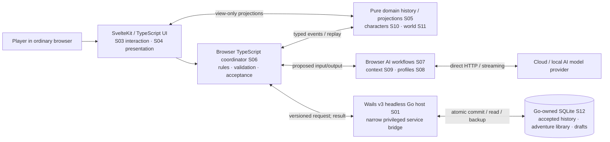
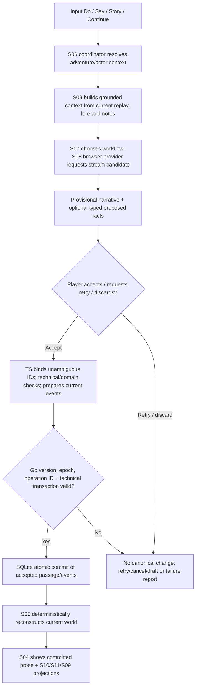

# Lorebound — System Architecture Overview

> **Where implementation stands now:** For the single current task, verified vs unverified feature coverage, changing technical context and next development handoff, see the [live Development Control Centre](../development/README.md), [NOW](../development/NOW.md) and [52-idea feature ledger](../development/FEATURES.md). This architecture overview describes the system and approved design, not a substitute for implementation evidence.

> **Start here for the whole application.** This is the current, self-contained architectural overview of what Lorebound is intended to do, how the finished pieces fit together, which technical boundaries matter, and what exists today. It synthesises the **52 user-approved production ideas** and later accepted Pass B1–B9 and Pass C decisions; it does **not** override their detailed contracts or imply all 52 ideas have been implemented. [Architecture decisions](./decisions/), [production ideas](../production/), [visual design](../design/README.md), [historical consolidation](./Consolidated%20Subsystem%20Architecture.md), and [Pass C slice register](./Pass%20C%20-%20Implementation%20Slice%20Register.md) provide the drill-down records.

## 1. Lorebound in one minute

**Lorebound is a local-first, single-player, account-free, AI-assisted interactive-fiction writing environment.** The player leads the story; the AI generates and interprets possible prose and facts, while the application remembers **only accepted fiction** and reconstructs its current world consistently. Lorebound is a **storytelling/editorial system with optional game rules**, not a compulsory RPG simulation or autonomous narrator with authority to change the player's story.

The experience combines:

- A readable, **directly editable story document** with **Do, Say, Story and Continue** input modes, Retry, Undo, selected-history editing and explicit acceptance.
- **Adventures** with independent history and worlds, blank/Quick Start/custom/template openings, save/resume/duplicate/fork and eventual full-library backup.
- **AI orchestration** through the player's chosen browser-accessible cloud/local provider: streaming, configurable generation workflows, capability-aware model settings, narration style, grounded state interpretation and bounded repair.
- **Remembered fiction**: typed, current-only accepted event history; deterministic projections of characters, lore, inventory, places and relationships; generated/selected contextual memory.
- **World and character views**: universal characters with optional Playing As identity, presence/status/anatomy, unique items and equipment, locations/routes/conditions and an accessible, basic **semantically scaled spatial map**.
- A **Command Citadel visual language**: parchment editorial prose on warm charcoal, antique-gold actions, a 320px contextual rail at desktop, a docked composer, responsive alternative views and honest blue-pending/green-confirmed feedback.

**Current implementation evidence (2026-11-06):** Merged [DEV-002A PR #4](https://github.com/Levelleor/lorebound/pull/4) replaces Gate 0's test screen/service with real blank adventure creation, listing and resume through **Wails v3, SvelteKit and Go-owned SQLite**. Atomic empty Turn-0 initialization, independent identities, recovery and browser/process restart have [passing evidence](../development/evidence/DEV-002A.md), including scoped Command Citadel entry/blank-reader visuals. IDEA-0006/R01–R03 are verified; IDEA-0006/0051/0053 remain partial. Merged [DEV-002B PR #6](https://github.com/Levelleor/lorebound/pull/6) adds Story input, explicitly simulated provisional continuation and atomic acceptance of separate structured authored/generated passages with zero world effects; [scoped evidence](../development/evidence/DEV-002B.md) includes final-head CI and independent real-browser/restart verification. Live providers, nonempty world events, Lorebook, map and the complete game engine remain planned. **All 52 original ideas are in `planning/production/` (approved for implementation); zero are staged; no complete idea has been archived as implemented.** Future features must be separately built and evidenced, in small slices. **B9-D12 spatial event/schema migration is explicitly deferred** and not part of today's work.

Merged [DEV-002C PR #8](https://github.com/Levelleor/lorebound/pull/8) completes the bounded DEV-002 parent integration/verification: coalesced deferred cross-tab refetch, retained input and recovery diagnostics, expanded real-browser failures and exact restart persistence. [Evidence](../development/evidence/DEV-002C.md) includes independent review and final-head CI. This closes only the Story-only simulated zero-effects parent; full original IDEA scopes remain partial. Merged [DEV-003A PR #10](https://github.com/Levelleor/lorebound/pull/10) adds provisional replace-on-Retry with immediate invalidation, preserved input on failure/Stop, latest-only acceptance and existing save/conflict fencing; [evidence](../development/evidence/DEV-003A.md) includes final-head CI and independent review. At DEV-003A closure, eight original ideas had partial evidence. **DEV-003B is verified/merged in [PR #12](https://github.com/Levelleor/lorebound/pull/12)** on 2026-11-06, as confirmed in its [delivery record](../development/evidence/DEV-003B.md). A small fork icon beneath any accepted Story turn creates its complete supported zero-effects prefix/baseline in an independent adventure and opens it in a separate browser tab/window, default `fork: [source name]`, preserving source history/input. [Evidence](../development/evidence/DEV-003B.md) covers atomic/version/epoch/idempotency safety, popup/recovery/navigation handling, independent futures and exact restart, with independent review. IDEA-0011 is PARTIAL: nine partial original ideas, zero complete, three formally certified IDEA-0006 rows. No original note is archived. Parent DEV-003 remains partial; rename, broader world-state copying and other children remain later.

**DEV-003C is verified/merged in [PR #13](https://github.com/Levelleor/lorebound/pull/13)** at `3632386d407efc0e40bfe9a8c9e7916a9fef9199`: the user accepted the review handoff and approved finalising/merging the shared latest Story composer draft child. [Requirements and verification](../development/requirements/DEV-003C.md) cover noncanonical debounce/reopen recovery, epoch/isolation guards, an additive nonspatial draft table and atomic consumption of matching accepted input. This makes IDEA-0005 PARTIAL: ten partial ideas, zero complete, three formal IDEA-0006 rows unchanged. Other modes, prose/manual-correction draft targets and library lifecycle remain later. Actual merge/final CI belongs in PR #13; B9-D12 remains deferred.

## 2. System at a glance

**Three decision-making boundaries, never conflated:**

| Boundary | Owns | Does **not** do |
| --- | --- | --- |
| **Browser UI + TypeScript domain** | Player interaction, provisional state, story intent, AI requests, stable entity binding, rules, typed accepted events, deterministic reducers and view projections | Direct canonical SQLite writes or independent persistent browser canon |
| **Go / Wails technical service** | Runtime lifecycle, narrow privileged OS/credential operations, validated service envelopes, SQLite transaction/version/epoch/idempotency checks and backup/restore gate | Narration, AI model HTTP proxy, a parallel gameplay simulation or deciding whether an accepted fictional event is plausible |
| **SQLite durable library** | One library with separate adventures, current accepted story/event record, noncanonical drafts, transaction history and future backup metadata | A second model-generated canon or mandatory revision archive of superseded passage bodies |

**Important negative space:** no player account/login; no native WebView as the primary UI; no separate Node player runtime; no independent Go rules engine; no browser IndexedDB canonical copy; no requirement for a second AI model, mandatory RAG/embeddings or a live-AI scenario test suite.

## 3. What a player experiences

### 3.1 Begin an adventure

The player opens a single local browser UI, sees their adventures, creates or resumes one, and may choose a **blank, Quick Start, custom or guided opening**. Reusable scenario templates and an optional generated initial world/Lorebook can enrich the beginning. Generation failures must not leave a phantom accepted first turn or unexpected committed adventure. Adventures are isolated, and duplicating or forking creates a separate logical continuation, not shared editable canon.

### 3.2 Write, act and continue

The story is an **editorial reading surface**, not chat bubbles. The player can **Do** an action, **Say** dialogue as an existing Playing As character, write **Story** prose freely, or request **Continue**; supported structured game actions are additional optional affordances. **Story mode is the first implementation slice** (accepted C-D04 A). Full actor-sensitive modes follow when supported.

The player may select who they are **Playing As**; this is a reference to a universal character, **not an obligatory permanent protagonist** or proof the character is physically present. Do/Say require a valid selected character where applicable.

### 3.3 Generation is proposed, acceptance is authoritative

A provider may stream a candidate narration and tentative operations, but **candidate text, pending manual edits and speculative facts are not canonical**. The UI differentiates them visually (blue provisional area), gives supported review/Retry/Discard or correction affordances and never presents a draft as saved fiction. The coordinator converts supported approved facts into typed operations, validates identities/technical contract and requests **one atomic Go/SQLite commit**. Only after successful acceptance do prose and eligible events appear as committed (quiet green confirmation), with a new version and deterministic replay. **Sending another request must not silently accept an earlier pending turn.**

The player can directly edit historical/current passages. Draft text may autosave **noncanonically**. Confirming a historical edit invokes the accepted current-only history rules, including **Keep Later** or **Truncate Later** where applicable; it does not automatically rewrite later prose or apply simulation-based veto to facts. Deliberate manual world/map corrections use the **single shared primary composer Commit/Discard overlay** covering action input, not a separate map-local toolbar.

### 3.4 Explore the remembered world

The app can present facts about characters, scene presence, statuses, body/anatomy, inventory and item custody, equipment, named places, containment, routes, discovery and mutable environmental state. A Lorebook holds narrative descriptions, beliefs/knowledge and selective context, not an independent competing inventory/position store.

The **primary map is a spatial canvas** with numeric geographically meaningful distances and nested coordinate frames. It is **not** an auto-arranged logical graph. Containment, geographic placement and explicit travel connections are distinct facts. New grounded locations can receive deterministic first positions in the **same accepted transaction** that creates them; unresolved relations use stable defaults/best-effort only within accepted bounds. Canvas pan/zoom/hover/select are visual, not travel commands. Basic map has **no map-specific keyboard controls and no visible scale bar**; other application controls remain keyboard-accessible. No advanced GIS editor is required. **Spatial event/schema migration remains deferred (B9-D12).**

### 3.5 Configure and remember

The player chooses provider profiles, compatible models/settings, generation style/parameters and context inputs; cloud/local calls originate **in the browser**. Lore, author notes, selected summaries and retrieval supply grounded prompt context; a token inspector can show **actual** context allocation. Local OS credential services safeguard secrets. UI theme/layout preferences are noncanonical and must never create gameplay events.

## 4. The accepted story-turn lifecycle

1. **Prepare:** gather selected adventure and actor, accepted current story/world/lore and any optional enabled capability constraints. The prompt describes fictional facts in **natural language**, not internal database IDs.
2. **Generate:** chosen cloud/local model returns a provisional response. One-pass or staged strategies are selectable; any cancellation, failure or retry cannot implicitly commit. No automatic fallback to another provider unless separately enabled under accepted user choice.
3. **Interpret:** accepted model-produced proposals may name natural places/characters; **TypeScript privately resolves them to stable IDs**. Never invent an ID to satisfy an ambiguous name. Unsupported facts may remain as prose without invented tracked state.
4. **Reconcile / validate:** TypeScript verifies supported typed event representations and reconciles grounded world facts. Once the player has accepted fiction, the model/rule system **cannot retroactively invalidate it merely because earlier narrative prerequisites seem impossible**. Rules can affect prospective actions; current fact projections preserve accepted outcomes. Technical invalidity (wrong type, identity, stale write, conflict) can still reject a commit.
5. **Persist:** Go atomically accepts/rejects the prepared batch against expected version, library epoch and idempotent operation identity. No split partial story/world commit. A failed write leaves the previous accepted state intact.
6. **Project:** pure deterministic replay creates current character, world, lore and map projections. Caches/summaries are derived and invalidated as appropriate; UI shows only confirmed accepted changes.
7. **Recover:** Retry, Undo, selected-history edits, Fork, cancellation, stale tab/library changes and restore follow explicit versioned/active-history rules. No permanent parallel immutable passage revision archive.

**First Story-mode slice** is deliberately narrower than the whole application: stable adventure/passage/turn identity, accepted prose and order, minimal typed current-event envelope (possibly **zero world effects**), Go technical commit and replay. Real host/SQLite Gate 0 verification is already evidenced, and this narrow zero-effects Story loop is now **verified in merged PR #6**. Full AI/provider and world-event integration remain planned.

## 5. The twelve logical subsystems

The architecture has **12 logical ownership areas**, not necessarily 12 separate processes, packages or deployment services. Browser TypeScript implements the story/domain-facing areas; Wails/Go supplies privileged technical runtime and persistence.

| ID | Subsystem | Responsibility in a sentence | Main boundary |
| --- | --- | --- | --- |
| **S01** | Application Host & Lifecycle | Launch the local browser experience, expose narrow Go services, manage OS secrets and distribution | Go runtime, host bridge, no login |
| **S02** | Adventure Library & Initialization | Create, list, resume, fork, duplicate and initialise independent adventures | No direct SQLite transaction implementation |
| **S03** | Narrative Interaction & Editing | Accept Do/Say/Story/Continue and explicit drafts/history-edit workflows | Input is not automatically canon |
| **S04** | Presentation & Accessibility | Display readable story, map, contextual views, feedback and responsive UI | Views do not commit or travel by themselves |
| **S05** | Canonical History & Reconstruction | Maintain active accepted passage/event history and deterministic replay | One current canon; no competing revision archive |
| **S06** | Gameplay Coordination & Capabilities | Orchestrate turns, optional rules/plugins, validation and approval boundaries | No independent plugin/AI canon writes |
| **S07** | AI Workflow & Interpretation | Run candidate-generation strategy, provisional lifecycle, cancellation and interpretation | AI output is proposed, not authority |
| **S08** | AI Connections & Configuration | Choose and call browser-accessible providers/models; manage parameters/style/settings | No Go model HTTP proxy |
| **S09** | Lore, Context & Memory | Maintain descriptive lore, derive/retrieve memory and build prompt context | No independent character/item location truth |
| **S10** | Character & Scene State | Maintain universal characters, selected Playing As, scene/presence, status and anatomy | Selection is not physical presence |
| **S11** | World, Travel & Inventory | Own unique item custody, equipment, location containment, routes and semantic spatial geometry | Geography is not route connectivity |
| **S12** | Storage & Backup | Go-exclusive SQLite transactions, drafts, concurrency control, consistent full-library backup/restore | No browser-local canon |

### Key integrations

- **S03/S04 → S06:** UI expresses player intent and pending edits; coordinator decides which supported operations can be presented for acceptance.
- **S09/S10/S11 → S07/S08:** grounded projections and selected lore build the natural-language model context; browser calls the chosen provider directly.
- **S07 → S06/S05:** generated narration and interpreted facts are proposals; they do not directly write a database.
- **S06/S05 → S12:** typed prepared current events/prose are submitted through the narrow Go bridge; Go checks technical integrity and commits atomically.
- **S05 → S04/S09/S10/S11:** deterministic current-history replay drives all views and derived context. No view may become a second source of canon.
- **S11 → S04:** stable semantic locations and map geometry are rendered; pan/zoom/hover remain disposable viewport state and do not change travel or accepted coordinates.

## 6. Feature catalogue: all 52 approved ideas by owner

**Meaning of "approved":** Every item below is a **production-stage design/implementation planning approval**, not evidence of shipped functionality. **Each link is the same original `IDEA-` note** with approval history. For exact implementation contracts, later B/C ADR decisions take precedence over superseded wording within an older note.

### S01 — Host and lifecycle (3)

- [IDEA-0001 — Single-player account-free experience](../production/Single-Player%20Account-Free%20Experience.md): one local player's independent adventures, no login.
- [IDEA-0053 — Localhost startup and offline mode](../production/Localhost%20Startup%20and%20Offline%20Mode.md): Wails headless Go and ordinary browser lifecycle.
- [IDEA-0061 — Lorebound branding and engine split](../production/Lorebound%20Branding%20and%20Engine%20Split.md): product identity and separation between player UX and engine.

### S02 — Adventure library and starts (5)

- [IDEA-0005 — Adventure save/export management](../production/Adventure%20Save%20and%20Export%20Management.md): library lifecycle and noncanonical saved drafts.
- [IDEA-0006 — Quick Start and custom openings](../production/Quick%20Start%20and%20Custom%20Story%20Openings.md): blank, custom and generated initial story paths.
- [IDEA-0008 — Reusable scenario templates](../production/Reusable%20Scenario%20Templates%20and%20Placeholders.md): optional template-defined setups.
- [IDEA-0011 — Manual generation branches](../production/Manual%20Generation%20Branches.md): player-directed alternatives and independent continuations.
- [IDEA-0066 — AI-generated starting Lorebook/world](../production/AI-Generated%20Starting%20Lorebook%20and%20World.md): optional generated grounded initial lore, subject to acceptance.

### S03 — Narrative input and editing (4)

- [IDEA-0002 — Freeform player action modes](../production/Freeform%20Player%20Action%20Modes.md): Do, Say, Story, Continue.
- [IDEA-0003 — Direct editable prose document](../production/Direct%20Editable%20Prose%20Document.md): edit story text as a document, not chat bubbles.
- [IDEA-0041 — Historical edit confirmation/truncation](../production/Historical%20Edit%20Confirmation%20and%20Bulk%20Truncation.md): keep or remove later turns through explicit choice.
- [IDEA-0050 — Structured UI game actions](../production/Structured%20UI%20Game%20Actions.md): typed action affordances where supported.

### S04 — Presentation and accessibility (2)

- [IDEA-0037 — Zoomable node/map canvas](../production/Zoomable%20Node%20Map%20Canvas.md): basic render of semantically scaled world geography.
- [IDEA-0062 — Accessibility and customisable interface](../production/Accessibility%20and%20Customisable%20Interface.md): readable responsive shell, keyboard-operable app controls and UI preferences.

### S05 — History and reconstruction (4)

- [IDEA-0004 — Retry, Undo and alternate continuations](../production/Retry%20Undo%20and%20Alternative%20Continuations.md): recover or choose current accepted timeline.
- [IDEA-0039 — Event-sourced world history](../production/Event-Sourced%20World%20History.md): ordered accepted current assertions.
- [IDEA-0040 — Versioned text blocks and stable passage IDs](../production/Versioned%20Text%20Blocks%20and%20Revision%20IDs.md): logical passage identity; **B3-D04 later excludes a stored passage revision archive**.
- [IDEA-0042 — Snapshots and incremental rebuild](../production/Snapshots%20and%20Incremental%20State%20Rebuild.md): optional disposable replay accelerators, never an alternative canon.

### S06 — Coordinator and capabilities (4)

- [IDEA-0044 — Deterministic adventure coordinator](../production/Deterministic%20Adventure%20Coordinator.md): browser-side turn/commit orchestration.
- [IDEA-0046 — Typed tool rejection and narrative repair](../production/Typed%20Tool%20Rejection%20and%20Narrative%20Repair.md): bounded validation and repair of proposed operations.
- [IDEA-0047 — Native gameplay capability registry](../production/Native%20Gameplay%20Capability%20Registry.md): typed optional capability discovery and permissions.
- [IDEA-0055 — Optional RPG mechanics plugins](../production/Optional%20RPG%20Mechanics%20Plugins.md): opt-in mechanics that guide future actions without revising accepted fiction.

### S07 — AI workflow and interpretation (4)

- [IDEA-0017 — One-model task routing](../production/One-Model%20Task%20Routing.md): task/profile/model resolution, without requiring a second model.
- [IDEA-0018 — Configurable generation pipelines](../production/Configurable%20Generation%20Pipeline%20Strategies.md): one-pass and staged generation workflows.
- [IDEA-0019 — Streaming, cancellation and diagnostics](../production/Streaming%20Cancellation%20and%20Generation%20Diagnostics.md): provisional stream lifecycle, error/retry/stop.
- [IDEA-0045 — LLM state interpreter and proposals](../production/LLM%20State%20Interpreter%20and%20Proposed%20Operations.md): interpret candidate fiction into safe grounded typed proposals.

### S08 — Providers, model settings and author direction (7)

- [IDEA-0010 — Narration style and perspective controls](../production/Narration%20Style%20and%20Perspective%20Controls.md): selected prose style.
- [IDEA-0012 — Cloud LLM provider connectors](../production/Cloud%20LLM%20Provider%20Connectors.md): browser-initiated cloud API calls.
- [IDEA-0013 — Local LLM server connections](../production/Local%20LLM%20Server%20Connections.md): browser-accessible local models.
- [IDEA-0014 — Provider profiles and discovery](../production/Provider%20Connection%20Profiles%20and%20Discovery.md): configurable endpoints/models.
- [IDEA-0015 — Model capability-aware controls](../production/Model-Capability-Aware%20Controls.md): hide/disable unsupported effective request options.
- [IDEA-0016 — Sampling presets and advanced parameters](../production/Sampling%20Presets%20and%20Advanced%20Parameters.md): effective decoding settings.
- [IDEA-0025 — Author notes and persistent instructions](../production/Author%20Notes%20and%20Persistent%20Story%20Instructions.md): selected editorial constraints and reusable direction.

### S09 — Lorebook and memory (5)

- [IDEA-0020 — Entity-based Lorebook](../production/Entity-Based%20Lorebook.md): descriptive facts, links and knowledge.
- [IDEA-0021 — Conditional Lorebook activation](../production/Conditional%20Lorebook%20Activation.md): grounded inclusion rules.
- [IDEA-0022 — Automatic long-term summaries](../production/Automatic%20Long-Term%20Story%20Summaries.md): derived, invalidatable memory.
- [IDEA-0023 — Episodic memory retrieval](../production/Episodic%20Memory%20Retrieval.md): selective recall of recorded passages.
- [IDEA-0024 — Token-budgeted context builder/inspector](../production/Token-Budgeted%20Context%20Builder%20and%20Inspector.md): measured context composition and inspection.

### S10 — Characters and scenes (6)

- [IDEA-0007 — Character creation and starting choices](../production/Character%20Creation%20and%20Starting%20Choices.md): optional initial actor setup.
- [IDEA-0026 — Shared PC/NPC character entities](../production/Shared%20PC%20and%20NPC%20Character%20Entities.md): universal stable character identities.
- [IDEA-0027 — Customisable character status sheets](../production/Customisable%20Character%20Status%20Sheets.md): mutable optional tracked attributes.
- [IDEA-0031 — Anatomy and transformations](../production/Configurable%20Anatomy%20and%20Transformations.md): flexible body/physical features.
- [IDEA-0034 — Presence and current scene](../production/Character%20Presence%20and%20Current%20Scene.md): current place, transit and remote participation.
- [IDEA-0064 — Automatic character sheet tracking](../production/Automatic%20Character%20Sheet%20Tracking.md): grounded updates to accepted sheets.

### S11 — World, travel and inventory (6)

- [IDEA-0029 — Persistent items and inventory transfers](../production/Persistent%20Items%20and%20Inventory%20Transfers.md): one item identity and coherent custody.
- [IDEA-0030 — Equipment slots and body diagram](../production/Slot-Based%20Equipment%20and%20Body%20Diagram.md): equipment/body linkage.
- [IDEA-0033 — Hierarchical world locations](../production/Hierarchical%20World%20Locations.md): stable groups and containment.
- [IDEA-0035 — Configurable travel graph rules](../production/Configurable%20Travel%20Graph%20Rules.md): explicit traversable routes, distinct from map distance.
- [IDEA-0036 — AI world discovery and expansion](../production/AI%20World%20Discovery%20and%20Expansion.md): candidate grounded location/world additions.
- [IDEA-0038 — Persistent location state/travel interactions](../production/Persistent%20Location%20State%20and%20Travel%20Interactions.md): mutable place details and recorded travel state.

### S12 — Storage and backup (2)

- [IDEA-0051 — Go-owned browser-persistent story database](../production/Browser-Persistent%20Story%20Database.md): one SQLite library, atomic technical transaction authority.
- [IDEA-0052 — Backup/export and storage quotas](../production/Backups%20Export%20and%20Storage%20Quotas.md): consistent full-library backup/restore and storage safeguards.

**Total = 3 + 5 + 4 + 2 + 4 + 4 + 4 + 7 + 5 + 6 + 6 + 2 = 52.** For all secondary ownership, see the [subsystem mapping register](./Subsystem%20Mapping%20Register.md).

## 7. Durable data and state model

| Data category | Authority | Lifetime and rules |
| --- | --- | --- |
| **Accepted prose / active history** | S05, atomically persisted through S12 | Current accepted logical passages/turns and typed outcome event ordering; no required parallel archive of rejected/superseded revisions |
| **Current world facts** | Typed events/projections S05 + S10/S11 | Declarative accepted Set/Clear/create/remove/keyed facts; later accepted outcomes survive loss of earlier explanatory setup |
| **Noncanonical drafts / attempts** | S03/S07 with technical saving in S12 as needed | Draft editor inputs, pending corrections and provider output may be discarded/retried; never counted as accepted story |
| **Derived summaries / context** | S09 | Invalidate/recompute on relevant history edits; no independent authority over canon |
| **Map semantic geometry** | S11 typed current state | Stable nested frames, coordinates, sizes, region extents and route anchors in accepted events; **not** a derived screen layout |
| **Map viewport / UI preferences** | S04 local presentation state | Pan/zoom/theme/density/rail selection disposable or UI-only; not canonical gameplay events |
| **Provider profiles / secrets** | S08 settings; S01 protected OS credential storage | Avoid secret values in adventure SQLite or story prompts |
| **Library technical identity** | S12 Go/SQLite | Expected adventure version, library epoch, idempotency/operation IDs, stale tab rejection and atomic commit/restore fencing |

**Event/replay invariants:** only supported typed events are replayed; ambiguous identities are not guessed; accepted world facts never come from unaccepted model output; snapshots cannot alter correctness; current-only history is selected explicitly for Undo/history editing. Partial commits must fail closed.

**Storage safety:** one Go-owned SQLite database for a shared library, logically independent adventures, separate noncanonical drafts and consistent whole-library backup/restore under exclusive maintenance gating. A Restore or library-directory change rotates the library epoch, invalidating stale tabs/writes. **Do not interpret this overview as permission to implement deferred B9-D12 spatial event/schema migrations.**

## 8. Map and geography model (not a graph visualisation)

- **Geographic geometry:** typed coordinates in nested local frames; group transforms, scale and mutable region outlines persist as accepted story/world state. Metres can be inferred from qualitative geography using versioned deterministic interpretation, with explicit best-effort/default fallback when evidence is insufficient for resolved entities.
- **Containment:** a city within a country, or room within a building, is a separate keyed relation and does not imply a traversable edge.
- **Travel topology:** routes/doors/portals are independently grounded and keyed. Map distance and travel length/cost are **not interchangeable**, and no implicit route appears merely because two pins or areas touch.
- **Lifecycle:** creation of several grounded locations and their initial map positions can be one versioned atomic accepted batch. Deterministic coordinator reconciliation runs on relevant accepted changes, not pan/zoom/redraw; unresolved geography produces a simple nonblocking notice (B9-D13 B) without rewriting established story facts.
- **Visual behaviour:** basic pointer pan, zoom, hover and select; selected place opens recorded details and does not travel; player manual correction uses shared pending Commit; no map-specific keyboard interaction, visible scale bar, complex GIS editor or automatically followed character movement. Map opening/reselection reflects selected Playing As location when known and deterministic defaults otherwise.
- **Specific exception:** [B9-D12](./Pass%20B9%20-%20Typed%20Spatial%20Data%20and%20Runtime%20Integration%20Contract%20Review.md) migration choice was **deferred** with the instruction to do nothing yet. This does not prohibit new approved features but does prohibit silently running a spatial data migration.

## 9. User interface and design language

The approved [Command Citadel design reference](../design/README.md) is the visual target **for the finished app**. DEV-002A verifies entry/blank-reader surfaces; DEV-002B verifies the Story-only docked composer and provisional/committed states. World UI and full appearance controls remain planned.

- **Desktop:** 48px header; centre-reading main pane (outer max 672px), dark 320px context rail with **Scene / Items / Lore / Context** tabs; main story and rail independently scroll; primary multi-line composer docked below reader.
- **Responsive:** below 1024px switch between Story and World; hide location breadcrumb below 768px; simplify compact controls/forms below 640px. No sideways overflow.
- **Type:** Cormorant Garamond editorial narrative (21px default, 1.625 line height, user-selectable 15–28px); IBM Plex Sans controls; IBM Plex Mono technical labels.
- **Colour:** warm charcoal background, parchment body copy, antique-gold active controls; blue dashed provisional result; green checked committed facts; restrained red stop/destructive. Exact OKLCH values and Dark/Bright/Midnight appearance variations are recorded in [palette/presets](../design/palette-and-presets.css).
- **Semantics:** clear selected/focus/disabled states, truthful Connected/Saved labels, responsive accessible non-map controls and focus-managed dialogs. Style must never silently change pending acceptance or map interaction contracts.

For screen-by-screen states, see the [UI interaction map](../design/Lorebound%20UI%20Interaction%20and%20State%20Mapping.md).

## 10. Current implementation status and intended development sequence

| Area | Current evidenced status (2026-11-09) | What remains |
| --- | --- | --- |
| Wails v3 headless Go + SvelteKit ordinary browser | **Real adventure service/browser integration verified on Linux**, merged [PRs #4](https://github.com/Levelleor/lorebound/pull/4) / [#6](https://github.com/Levelleor/lorebound/pull/6); [evidence](../development/evidence/DEV-002B.md) | Full launcher/instance/Quit lifecycle, sensitive-service security and platform packaging |
| Go SQLite adventure library | **Blank creation and atomic Story passage/receipt append, isolation, stale/epoch rejection, rollback and reopen verified** through DEV-002B; separate Story input drafts verified/merged in PR #13 | Nonempty world events, cross-passage edits, other draft targets, backup/restore and broader integration; generated-passage editing is merged in PR #16; authored editing is verified/merged in PR #17; temporary passage-editor history in DEV-003H is verified/merged in PR #18; same-tab reload save recovery in [DEV-003I](../development/requirements/DEV-003I.md) is verified/merged in PR #19 |
| Adventure/story turn + TypeScript coordinator | **Story-only simulated proposal/Retry → explicit accept → Go atomic persist → refetch/replay/reopen verified** through [DEV-003A](../development/evidence/DEV-003A.md) | Bounded local model narration follows DEV-004A below; other modes, nonempty world events and broader later-feature integration remain later |
| Independent Story-prefix Fork | **Verified/merged within supported Story-only zero-effects scope in PR #12**; [evidence/review](../development/evidence/DEV-003B.md). Per-turn icon, separate tab and automatic name; source preserved | Same-tab Fork reload recovery in [DEV-003J](../development/requirements/DEV-003J.md) is verified/merged in confirmed PR #20; nonempty world/Lorebook/memory/plugin and full lifecycle integration remain later; no branch tree or revision archive |
| Shared latest Story composer draft | **Verified/merged in PR #13**; [scope/coverage](../development/requirements/DEV-003C.md). Latest input restores independently of canon; acceptance consumes matching input atomically | Other modes, manual-correction drafts, cross-reload uncertain-commit recovery and broader library lifecycle; generated-passage drafts follow PR #16 below |
| Temporary Story input Undo/Redo | **Merged in PR #14**, with [historical scope](../development/requirements/DEV-003D.md). The user subsequently rejected this composer-only choice; custom input history was removed by confirmed merged PR #15 | Native composer editing and latest-draft autosave remain; passage-editor history in DEV-003H is verified/merged in PR #18; no revision/candidate archive |
| Committed Story turn Undo | **Verified/merged in PR #15**, [DEV-003E](../development/requirements/DEV-003E.md): latest-turn removal, monotonic version/count separation and fresh reconstruction of the supported zero-effects prefix; CI/independent review pass; user accepted functionality and authorised finalisation | Nonempty world/correction/module replay and broader prose editing remain later |
| Direct model providers and full AI workflow | [DEV-004A](../development/requirements/DEV-004A.md) **verified on confirmed PR #21 merge after approved closure/checks**: direct browser completed local narration and Go-owned nonsecret shared profiles/optional discovery; explicit simulation selection | Separate live Qwen3/ROCm/Linux Firefox smoke PASS; universal server/model/OS interoperability remains unverified. Other named local adapters, cloud/credentials, streaming, interpretation and context remain later |
| Accepted generated-passage editing | **Verified/merged in PR #16**; [DEV-003F scope/coverage](../development/requirements/DEV-003F.md): inline per-target drafts and explicit Keep/Delete/Continue/Discard; reviewed application CI and independent review PASS, user approved merge/closure | Authored editing is verified/merged in [DEV-003G PR #17](../development/requirements/DEV-003G.md); cross-passage edits, nonempty world/derived/module replay and cross-reload uncertain-operation persistence remain later |
| Lore/memory, characters, world, map, plugins | **Approved design only** | Incremental implementation and honest tests; no blanket completion claim |
| UI visual fidelity | **Entry and Story-only reader/composer, provisional/committed states and four-width Dark/Bright checks verified** through DEV-002B | Full world/UI surfaces, appearance controls and complete accessibility certification |
| Original 52 production ideas | **52 approved notes, zero staging, no completed specs/archive** | Implement and verify individually or in dependency-aligned slices |
| Spatial event/schema migration | **Deferred by B9-D12** | No work until a distinct explicit future decision |

**Current integrated development:** follow [NOW](../development/NOW.md). The DEV-003 remaining-scope audit identified passage-identity decisions and later subsystem dependencies; its parent stays PARTIAL. The user separately authorised a bounded DEV-004 child, and DEV-004A implements local browser narration/profiles through the existing explicit-acceptance Story loop. Closure starts no next child; subsequent DEV-004 selection requires a separate launch. **Approval to move all ideas into production was not an instruction to implement every feature simultaneously.**

**Known early risk:** a hostile local process that bypasses browser headers is not fully authenticated by Gate 0's origin checks; guard privileged/private methods before extending their scope. Evaluate epoch/idempotency order when library restore rotates the epoch. DEV-002A tests creation-receipt epoch fencing; restore itself remains unimplemented. These are limits to consider during the relevant future slices, not evidence that current blank-adventure operations fail.

## 11. Architecture rules that must survive implementation

1. **Player accepted fiction is sovereign:** optional prospective rules can constrain proposals, but must not retroactively erase accepted story outcomes.
2. **One current canonical story:** stable passage/turn identity and deterministic current replay, **not a hidden historical passage-revision archive**.
3. **No model/renderer direct canon writes:** browser TypeScript prepares and replays; Go validates technical contract and saves atomically; UI displays projections.
4. **Separate fiction from representation:** natural narrator names vs private stable entity IDs; story assertions vs engine-derived geometry; geographic distance vs explicit routes.
5. **No fictitious evidence:** mocked tests demonstrate mock boundaries; real host/SQLite/browser claims require actual observed runs. Current approved design does not mean implemented feature.
6. **Uncommitted is not committed:** draft/provisional/pending visual states stay visibly distinct; accepted manual changes use the shared composer controls.
7. **Conservative feature surface:** basic map/no map keyboard gestures; one user and no login; local-first; browser-side AI requests; plugins must respect the capability gateway.
8. **Preserve deferrals and security gates:** no B9-D12 spatial migration; no automatic broad schema rewrite or sensitive Go API before its boundary is safe.

## 12. How to use and maintain this document

**Reading order for contributors:** this overview → [visual design](../design/README.md) for UI tasks → relevant [production IDEA](../production/) → accepted [architecture ADR](./decisions/) → current code/tests and [Gate 0 evidence](./Gate%200%20Execution%20Evidence.md). Historical consolidation and Pass reviews are for **provenance**, not competing live summaries.

**Authority precedence:** explicitly accepted later user decision/ADR for specific behaviour → current production idea qualified by that decision → this synthesised overview → historical proposals and brainstorms. If a genuine contradiction remains, record it and obtain a targeted decision rather than silently choosing an older clause. Do **not** rewrite historic approvals to make chronology disappear.

**Maintenance rule:** update this **single current-state overview** when accepted architectural scope or verified implementation status materially changes. Keep feature counts and links accurate; mark unbuilt features as planned. Do not append hundreds of dated batch records here; put decision history in ADRs and change notes in their appropriate documents. Link this overview from README, planning Start Here and agent instructions.

**Trace sources:** [52-idea mapping](./Subsystem%20Mapping%20Register.md); [full production promotion audit](./Pass%20C%20-%20All%20Accepted%20Ideas%20Production%20Promotion%20Register.md); [B9 and Pass B closure](./decisions/P-B9-01%20-%20B9%20and%20Pass%20B%20Design%20Closure%20with%20Deferred%20Spatial%20Migration.md); [Pass C accepted approach](./Pass%20C%20-%20Implementation%20Slice%20Refinement%20Kickoff.md); [Gate 0 evidence](./Gate%200%20Execution%20Evidence.md); [visual contract](../design/Lorebound%20Command%20Citadel%20Visual%20Design%20Contract.md).

---

*Published 2026-11-03 as the single current-state architectural entry point. This is a synthesis of existing user-approved design and verified evidence, not a new authorisation to change application behaviour, implement migration or declare all features complete.*
