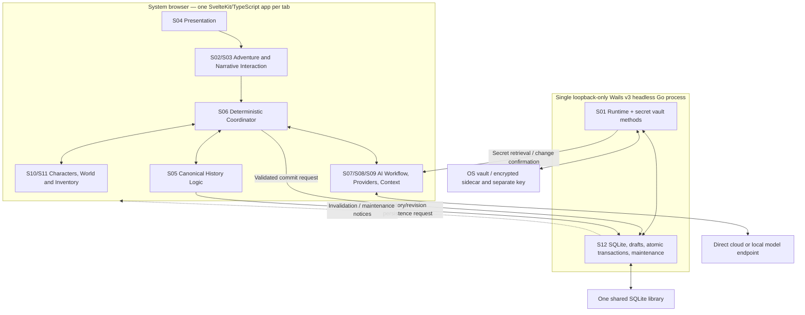

# Pass B1 — Architecture Foundations (Draft)

> **Review status:** **All six B1 design decisions accepted**, in two explicit user review batches on **2026-10-25**. See the linked individual ADRs in §9. **B1 is not yet technically verified or formally closed:** the feasibility gates in §8 remain unexecuted, the separate plugin-trust question is unresolved and the inherited `auth` wording should be clarified. Illustrative contracts and implementation details outside the six ADRs are not approved by implication. The 12-subsystem ownership consolidation was accepted previously. No staging idea is promoted by this document.

## 1. Source of authority and scope

Primary planning sources:

- [Consolidated Subsystem Architecture](./Consolidated%20Subsystem%20Architecture.md), especially §2, §5–7: approved 12 logical subsystem responsibilities and inherited constraints.
- [Pass A Closure Audit](./Pass%20A%20Closure%20Audit.md): 30 dispositions, distinction between superseded/approved choices and open implementation engineering.
- [Subsystem Mapping Register](./Subsystem%20Mapping%20Register.md): original individual idea ownership, dependency history, and traceability.
- Relevant staging sources: [IDEA-0053 runtime](../staging/Localhost%20Startup%20and%20Offline%20Mode.md), [IDEA-0051 database](../staging/Browser-Persistent%20Story%20Database.md), [IDEA-0044 coordinator](../staging/Deterministic%20Adventure%20Coordinator.md), [IDEA-0039 history](../staging/Event-Sourced%20World%20History.md), [IDEA-0047 registry](../staging/Native%20Gameplay%20Capability%20Registry.md), [IDEA-0014 credentials](../staging/Provider%20Connection%20Profiles%20and%20Discovery.md).

**B1 scope:** resolve *system-level* architecture and dependency contracts, establish testable feasibility gates, and identify subsequent B2/B3 design questions. Do **not** decide the exact SQLite schema, every TypeScript type, Go method names, directory structure, plugin runtime or UI implementation. The original user-approved staging behavior prevails if this draft differs.

## 2. Accepted constraints that B1 must preserve

1. **One product, one selected player runtime:** a Wails v3 headless Go process serving a static/client-rendered SvelteKit app to an ordinary browser; no parallel WebView desktop product or Node player server.
2. **Browser TypeScript** owns gameplay rules/coordinator, interpreter, context and provider connections. Model calls go **directly from browser to provider/local endpoint**, not through Go.
3. **Go** owns the single SQLite library, filesystem, whole-library backup/restore maintenance, OS vault or consented separately keyed encrypted sidecar, and atomic expected-version writes. Canonical persistence is not browser-local.
4. **Only validated, committed narrative revisions and world events are canon.** AI streams/proposals and autosave drafts are noncanonical. One active story timeline; no in-adventure alternate-branch UI. Core/supported-module history is reconstructible, with the accepted missing-plugin exception.
5. **No Lorebound account or application-login/authenticated-session framework** in this iteration (A-27); no unverified guarantee against hostile local programs. This excludes neither provider API keys nor basic browser-origin/loopback filtering.
6. Existing generation/validation strategies are authoritative: **no extra AI review stage or Go-side gameplay/narrative validation**, no automatic alternate-model fallback on failure.
7. **Go controls maintenance:** globally fence all library/draft writes before full-library backup/restore, safely settle in-flight transactions, and reject stale library epochs following restore or location changes. Other tabs' cooperation is not sufficient.
8. World-state invariants include stable entity IDs; distinct player **Story** authorial choice versus AI/Do/Say ordinary rules; maps are **not** travel controls; manual corrections are historied; no automatic migration/replay requirement for removed plugin-specific state.

These constraints are **already accepted**; the remainder of this document is **proposed** until reviewed.

## 3. Conceptual runtime topology

This diagram is a **responsibility/dataflow sketch**, not a module dependency graph, required process split, exact transport or promised runtime implementation. S01 includes conceptual app lifecycle, but only its privileged runtime part exists in Go. S02–S11 describe logical responsibilities, not one package each.

## 4. Proposed boundary contracts

| ID | Boundary | Proposed rule | Accepted basis |
| --- | --- | --- | --- |
| B1-R01 | View to application | UI components issue typed intents / display read models; no presentation operation directly writes canon. Map selection and layout are passive. | S03/S04; A-19/20/29 |
| B1-R02 | AI to coordinator | Generation, tool proposals and context are provisional; the coordinator applies the **already accepted** validation/repair strategy, not a new reviewer. A cancelled, superseded or failed attempt cannot commit. | S06/S07; A-12/23/24 |
| B1-R03 | Coordinator to domain | Native and UI-generated gameplay operations use the same capability/permissions/validation pathway. Domain modules implement their own rules behind S06, without private canonical stores. | S06/S10/S11; A-28 |
| B1-R04 | Domain/history to storage | Canonical write requests include sufficient source provenance and expected versions to bind prose revisions, events and active-history transitions into one durable transaction; exact envelope is B2/B3. | S05/S06/S12; A-07/22/25 |
| B1-R05 | Go write acceptance | Go checks **structural/storage constraints, expected adventure version, library epoch, maintenance gate and atomic commit**; no second fiction/domain/model judgement. A database rejection is never partial acceptance. | S12; A-22/24/25/27 |
| B1-R06 | Derived data | Lore summaries, projected read models, caches and snapshots are non-authoritative when stale. S05 governs historical selection and rebuilding; supported replay does not rerun models/external effects. | S05/S09; A-06/07/10 |
| B1-R07 | Provider boundary | S08 browser adapter sends direct requests and reports real provider failure; S07 handles lifecycle. No transparent reroute to a different model. Browser origin/provider CORS must be tested. | S07/S08; A-11/12 |
| B1-R08 | Credentials | S01/Go persists secrets outside SQLite; S08/browser only holds active-use secrets in memory, updates Go on edits and invalidates other tabs' cached copies where possible. No Go inference proxy. | A-04/27 |
| B1-R09 | Persistence events | Cross-tab notices signal that clients *should refetch* authoritative versions; a notification is **not** proof of committed data or substitute for Go transaction/version checks. | A-21/22/25 |
| B1-R10 | Extension boundary | Built-in and optional mechanics register through the typed capability contract. Mere permissions metadata is **not** proof of sandboxing malicious third-party JavaScript in a privileged same-origin browser context; treat isolation as an independent design/security concern. | IDEA-0047/0055; A-10/28 |

**Authority versus adversarial trust:** The normal application path treats S06 as *gameplay decision authority*, while Go is *durable transaction authority*. Because the accepted iteration omits app authentication, Go cannot credibly claim to prevent a hostile local process from submitting calls simply because browser-side S06 exists. Storage validation/constraints prevent accidents and partial transactions; they are not a substitute for an approved hostile-client security model.

## 5. Canonical authority classification (proposal)

| State or activity | Working owner | Durable authority and interpretation |
| --- | --- | --- |
| Unsubmitted editor input, provisional AI stream or tool proposal | S03/S07 | Not canonical; discard/abort on failure/cancel; drafts save separately under S12 when applicable |
| Accepted story passage revision and lineage | S05, requested through S03/S06 | Go/SQLite transaction under S12 makes it durable; active selector determines current canon |
| Accepted gameplay operations/events | S06 with S10/S11 rules and S05 provenance | Stored atomically in S12; deterministic replay of supported events, without model calls |
| Current character/world/item projection | S10/S11 via S05 reducers | Reconstructed from active authoritative history; browser values are replaceable read models |
| Generated memory/context selection | S09 | Derived/read-only for generation, subordinate to accepted facts and explicit exclusions |
| Provider profile settings (non-secret) | S08 | Persist using approved Go-managed app data arrangement; exact table/design deferred |
| Provider secret value | S01 Go vault/sidecar | Browser S08 may temporarily cache for direct requests; never in SQLite/draft/log |
| Global maintenance status/library epoch | S12 Go | Server-verified; all tabs must obey failures even if notices are missed |
| UI selection, map viewport and `Playing As` selection | S04/S10 settings | Noncanonical gameplay state; deliberate map edits and manual sheet corrections use distinct canonical operations |

## 6. Proposed dependency rules

- **Do not let S04 depend on SQL or provider protocol details.** Prefer a small application-facing interface between UI and orchestration/settings.
- **Do not let S10/S11 import Go/Wails APIs or call providers.** Their supported core rule/reducer logic should be usable with plain TypeScript values; permissions and state effects are interpreted through the common S06 path.
- **Do not let S08 adapters call S12 to commit game state.** An AI provider produces provisional responses and errors; S07/S06 coordinate what happens with them.
- **Do not let S12 import game-domain implementations.** Storage APIs enforce transaction, shape, expected version and epoch, not AI/domain policy. B2/B3 will specify which invariants also need database constraints.
- **Avoid a hard S06 ↔ S07 import cycle.** A composition/orchestration boundary can coordinate requests, offer context/AI services to S06 and return provisional results as data. Exact interface injection/callback layout remains to be designed.
- **Logical subsystems are not packages.** Start with domain modules and a narrow browser-to-Go service surface; decide package boundaries based on tested reasons, not the count of subsystem IDs.

## 7. Illustrative canonical commit path (not an API specification)

1. A browser tab reads the accepted adventure head/version and server library epoch.
2. The player supplies an intent or authorial edit. S06 coordinates any *already selected* S07/S09 generation and S10/S11 validation; all tentative outputs stay outside accepted canon.
3. S05 prepares provenance and active-history/revision consequences in a proposed durable change set.
4. Browser sends a version/epoch-bound **already validated** change request to S12. Go rejects maintenance/stale version/stale library epoch and enforces atomic storage constraints in one transaction.
5. On success, S12 returns the accepted version/commit identity; other tabs are notified to refresh. On conflict/failure, no partial event/prose/state is committed; provisional or recoverable input is handled according to A-21/23 rules.
6. A later restore/Undo/historical edit uses its *separate accepted operation*, preserving A-02/A-06/A-07 semantics.

Exact types, idempotency tokens, revision selection, expected-version conflict codes and write ordering belong to B2/B3.

## 8. Technical feasibility gates, not yet executed

| Gate | Verification / evidence required | Result |
| --- | --- | --- |
| **F-B1-01 Wails server runtime** | Pin a v3 version; build `-tags server`; verify embedded SvelteKit static assets, Go service binding from **ordinary** browser, bidirectional tab notifications, dynamic loopback port, startup/shutdown and no native WebView. | **Not tested** |
| **F-B1-02 Browser provider support** | Test each promised provider/local endpoint for browser-origin fetch/CORS/private-network rules, streaming, authentication headers, abort behaviour and model discovery. Unavailable endpoints fail honestly; **no Go proxy fallback**. | **Not tested** |
| **F-B1-03 Local service exposure** | Evaluate actual bound interfaces, Host/Origin, DNS rebinding, CSRF-style requests, credential-service access, browser reload and local-process access; document residual risks without adding rejected app-login/session tokens. | **Not tested** |
| **F-B1-04 Cross-tab atomicity** | Demonstrate two tabs attempting competing commits, stopped generation, missed WebSocket invalidations and epoch rejection after whole-library replacement. Only Go decides the durable winning write. | **Not tested** |
| **F-B1-05 Database lifecycle** | Test SQLite transaction failure/retry, WAL-consistent full-library backup, maintenance fencing, restore rollback/reopen and draft write rejection during maintenance. | **Not tested** |
| **F-B1-06 Plugin trust** | Assess whether plugin loading is first-party-only or arbitrary executable third-party JavaScript; a registry-level permission field cannot on its own isolate untrusted code running same-origin. | **Unresolved scope/implementation detail** |

**External feasibility evidence reviewed, not code-tested:** Wails v3 [server-build documentation](https://v3.wails.io/guides/server-build/) describes a `server` build tag, same-origin browser service bindings, browser-tab events and headless operation; [Wails v3 project home](https://v3.wails.io/) identifies the v3 framework as beta. These establish documented support, **not** an executed Lorebound proof.

## 9. Proposed B1 decisions for human review

| Proposal ID | Decision to make | Working recommendation | Status |
| --- | --- | --- | --- |
| **B1-D01** | Should built-in domain rules/reducers be independent of Svelte and Wails imports? | **Yes**, plain TypeScript domain logic with interfaces at application/platform boundaries; this supports deterministic replay and isolated tests. | **Accepted 2026-10-25**; [ADR](./decisions/B1-D01%20-%20Framework-Independent%20Domain%20Logic.md) |
| **B1-D02** | What is the dependency direction between coordinator, AI workflow and domain services? | Make S06 the gameplay authority and use application composition/service contracts to avoid circular module dependencies; S07 returns data, never commits. | **Accepted 2026-10-25**; [ADR](./decisions/B1-D02%20-%20Coordinator%20and%20Service%20Dependency%20Direction.md) |
| **B1-D03** | Which side may decide the outcome of a canonical write? | S06 decides fictional/domain acceptance; S12/Go alone decides durable transaction success, expected-version and epoch checks. | **Accepted 2026-10-25**; [ADR](./decisions/B1-D03%20-%20Gameplay%20and%20Durable%20Commit%20Authority.md) |
| **B1-D04** | How should cross-tab updates be treated? | Notifications are invalidation hints; clients refetch server versions. No shared-tab mutable authority and no optimistic assumption that a notification means commit. | **Accepted 2026-10-25**; [ADR](./decisions/B1-D04%20-%20Cross-Tab%20Invalidation%20and%20Refetch.md) |
| **B1-D05** | How wide should the browser↔Go method surface be? | Use a **small set of task-oriented storage/credential/maintenance operations**, not arbitrary SQL, filesystem-path access or general script execution; exact endpoints in B3. | **Accepted 2026-10-25**; [ADR](./decisions/B1-D05%20-%20Narrow%20Browser-to-Go%20Service%20Surface.md) |
| **B1-D06** | Where should event replay execute? | Browser TypeScript S05 using pure deterministic reducers; Go stores/paginates required history and optional checkpoints, without reimplementing gameplay reducers. | **Accepted 2026-10-25**; [ADR](./decisions/B1-D06%20-%20Browser%20TypeScript%20Event%20Replay.md) |

### Explicit risks and small source-wording correction to review

1. The [consolidated architecture §5](./Consolidated%20Subsystem%20Architecture.md) currently says “Go/SQLite enforces atomicity, **auth** and stale-version conflicts.” **A-27 explicitly excludes Lorebound application authentication**; the intended meaning should be clarified to “Go/SQLite enforces transactional integrity, maintenance/version checks and supported request filtering,” *not* user/session authentication. This draft **flags** the wording for an editorial amendment after review; it does not amend already accepted source text silently.
2. A TypeScript plugin running in the same browser origin might have broad access to in-memory secrets and service bindings regardless of what permissions its registry entry declares. This is a real **technical trust-boundary question** for B4, not an approved new sandbox feature.
3. Wails server build and direct browser-origin model connectivity have documentation support but **no Lorebound spike/test result yet**. These are critical feasibility gates before claiming release viability.

## 10. B1 review completion checklist

- [x] Review **B1-D01 through B1-D03**; each explicitly accepted 2026-10-25 with its own ADR.
- [x] Review **B1-D04 through B1-D06**; each explicitly accepted on 2026-10-25 and recorded in an individual ADR.
- [ ] Clarify the consolidated document’s ambiguous `auth` phrase consistently with A-27.
- [ ] Confirm whether design should treat browser-side native plugins as trusted code initially or defer isolation to a separate scope decision.
- [ ] Agree on F-B1-01–F-B1-06 owners and proof expectations. Feasibility is **not** marked passed without running checks.
- [x] Record **all six** accepted decisions as individual ADRs after explicit human approval, preserving source IDEA IDs and the staging/production gate.
- [ ] Complete B1 feasibility evidence review and resolve or expressly defer residual architectural risks before formally closing B1.
- [ ] Begin B2 and B3 together: canonical revisions/events/replay, turn commit envelope, version/epoch conflict behaviour and historical edits.

## 11. Change history

- **2026-10-24 — Initial B1 proposal only.** Established a reviewable draft from previously accepted Pass A/Pass B consolidation. No executable code, production promotion, new model pipeline, auth mechanism or new approved architecture decision is claimed.

- **2026-10-25 — Batch 1 human acceptance:** The requesting user explicitly accepted **B1-D01, B1-D02 and B1-D03**. Each approved rule is preserved as a standalone ADR under `planning/architecture/decisions/`. Unreviewed **B1-D04–D06 remain unapproved**. No other proposal, feasibility gate, software implementation, staging promotion, application authentication framework or additional AI validation stage was approved by this batch.

- **2026-10-25 — Batch 2 human acceptance:** Requesting user explicitly accepted **B1-D04, B1-D05 and B1-D06** without modifications ("Agreed on all"). Three new ADRs preserve rationale, alternatives, source scope and history. **All B1-D01–D06 are now accepted.** B1 remains **open for feasibility verification and bounded risk/wording review**, not implementation. No B2/B3 design work or staging promotion was authorised by this update.
